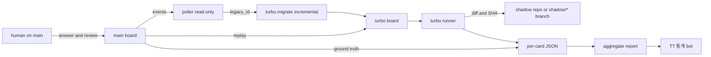

# Shadow run

이 문서는 설계다. 여기에 적힌 poller, shadow mode, replay, 비교 기록, 단계, 임계값, 그리고 mainplane에서 빌린 event log, step record, `idempotency_key`, upgrade 검사는 모두 **계획**이며 구현되어 있지 않다. 숫자는 사람이 고르기 전의 placeholder이고, 표에 TBD로 적혀 있다.

오늘 돌아가는 절차는 [TURBO.md](../TURBO.md)의 cutover다. 그 절차는 legacy claim을 멈추고 turbo를 권위 있는 board로 만든다. Shadow run은 그 결정 앞에서 하는 proof다. Shadow run이 돌아가는 동안 권위는 legacy main think-tank에 있다.

Mainplane에서 가져온 것은 설계 패턴뿐이다. 코드는 복사하지 않았다. 저작권 표시는 `Copyright (c) 2026 Alexander Yue`이고, 저장소는 [mainplane-ai/mainplane](https://github.com/mainplane-ai/mainplane), 라이선스는 MIT다. 출처와, 나중에 코드를 복사할 때의 규칙은 [CREDITS.md](../CREDITS.md)에 있다.

## 목표

Main이 실제 일을 한다. Turbo는 같은 입력을 받아 실제로 runner와 harness를 돌리되, 바깥으로 나가는 side effect는 막는다. 결과는 기록해서 main과 비교한다.

Turbo 쪽에서 main은 읽기 전용이다. Legacy board와 legacy DB에는 쓰지 않는다. 답, verdict, claim, lease, comment를 legacy 쪽에 만들지 않는다.

## 데이터 흐름



화살표는 turbo에서 main으로 돌아가지 않는다. 사람은 main만 본다.

## 입력 거울

작은 poller가 main board의 이벤트를 읽기 전용으로 읽는다. 읽기는 오늘 archive와 같다. Legacy 파일은 `mode=ro`와 `query_only`로 연다. Poller는 대응되는 turbo card를 만들고, 둘을 `legacy_id`로 묶는다.

가져오기는 `turbo.migrate`를 증분으로 쓰는 계획이다. 오늘의 `python -m turbo.migrate`는 일회성이고, 이미 있는 id는 다시 넣지 않는다. Shadow run은 그 성질을 이어서, 새로 생기거나 바뀐 main card만 turbo에 반영한다. Legacy 파일은 그대로 읽기 전용이다.

Board끼리 직접 붙이지 않는다. Main 서버를 turbo가 호출해 쓰지 않고, turbo 서버를 main이 호출하지도 않는다. Poller와 migrate가 유일한 다리다.

P1에서는 poller 대신 이미 끝난 card의 고정 export를 넣어도 된다. 입력은 card의 title, body, contract, scope, harness다. Main이 만든 해답 diff는 입력에 넣지 않는다. 그 export는 column snapshot이 아니라 append-only event log다. 상태는 log에서 다시 유도한다. P1은 그 log를 그대로 replay한다.

## Side effect 격리

Shadow mode에서 turbo의 작업 트리는 main repo가 아니다.

- 별도 repo나 fork, 또는 `shadow/*` branch에서 작업한다.
- 실제 upstream PR은 열지 않는다. Diff와 SHA만 기록한다. Fork 위에 PR을 남기는 것은 선택이다.
- Merge 판단은 기록만 한다. Main에 merge를 실행하지 않는다.
- 사람에게 알리지 않는다. Board ping, 메신저, wake가 없다.

Turbo card의 submit은 shadow tree의 SHA와 changed path를 남긴다. `gh pr create`와 `gh pr merge`는 이 모드에서 실제 remote에 나가지 않는다.

## 사람 응답의 replay

Turbo가 질문해도 사람을 부르지 않는다. 짝인 main card에 사람이 남긴 answer와 review를 turbo에 넣는다.

Main에 대응되는 답이 있는 turbo 질문은 그 답을 resume prompt로 받는다. Main이 끝까지 가는 동안 같은 질문을 하지 않았으면, 그 질문 자체를 divergence로 기록한다. 이름은 `question main never asked`다.

Timeout은 placeholder다. Turbo 질문이 생긴 뒤 main에서 대응 답이 없이 TBD 시간이 지나면 divergence를 기록하고 turbo card를 멈춘다. 제안값은 24시간이다. 사람이 확정하기 전에는 숫자로 쓰지 않는다.

Shadow 질문에는 `blocked_default`를 적용하지 않는다. 답은 main replay에서만 온다. `confirm: true`인 질문은 오늘의 규칙대로도 자동 적용되지 않는다.

Answer와 event post에는 `idempotency_key`를 둔다. Runner가 같은 post를 다시 보내면 log에는 한 번만 남는다. 재시도가 divergence로 세지지 않게 하려는 계획이다.

어떤 main 이벤트가 어느 turbo 질문에 대응하는지는 열린 질문이다. 아래를 본다.

## 카드마다 비교하는 것

짝마다 per-card JSON 하나를 남긴다. 모아서 aggregate report를 만든다. TT 통계 bot이 그 report를 차트로 그릴 수 있다. Bot을 바꾸는 일은 이 설계에 없다.

기록에 secret, bearer, work token, nonce를 넣지 않는다. 경로는 repo 상대 경로만 쓴다.

Card의 상태는 column을 덮어쓴 값이 아니다. Append-only event log에서 유도한다. Main과 turbo의 divergence는 그 두 log의 diff다.

Cost의 token은 card 합계 하나가 아니다. Turn마다 남긴 step record의 usage를 더한다. 각 step은 request의 sha256, model, harness version을 가진다. 같은 입력인지는 이 셋이 main step과 같은지로 본다. 모델이 달랐으면 outcome 차이를 구현 차이로 세지 않는다.

Outcome:

- 끝 상태. Main과 turbo 각각 merged인지, verdict가 무엇인지.
- 테스트가 통과했는지.
- Diff 크기.
- Main이 merge한 diff와의 overlap.

Flow:

- Lead time.
- Turn 수.
- Question 수.
- Human touch 수. Main에서 사람이 answer, review, edit한 횟수.
- Stall time. `working`인데 live handle이 없거나 handoff인 시간.

Contract:

- Main에서 실제로 난 violation.
- Turbo gate가 막은 이유. Scope violation, verify 없는 submit, red-green scenario가 base에서 통과하거나 head에서 실패한 경우.

Cost:

- Token 수. Step `usage`의 input, output, cache read, cache write를 합한다.
- Runtime.
- 같은 입력 여부. Step의 request sha256, model, harness version.

계획된 per-card 기록의 모양이다. 필드가 비어 있을 수 있고, 없는 값은 `null`이다.

```json
{
  "legacy_id": "main-card-id",
  "turbo_id": "turbo-card-id",
  "phase": "P1",
  "outcome": {
    "main_terminal": "merged",
    "turbo_terminal": "review",
    "main_verdict": "approve",
    "turbo_verdict": "",
    "tests_pass_main": true,
    "tests_pass_turbo": false,
    "diff_bytes_main": 0,
    "diff_bytes_turbo": 0,
    "overlap": null
  },
  "flow": {
    "lead_time_s": null,
    "turns": null,
    "question_count": null,
    "human_touches": null,
    "stall_time_s": null
  },
  "contract": {
    "main_violations": [],
    "turbo_blocks": ["scope violation"]
  },
  "cost": {
    "tokens": null,
    "runtime_s": null,
    "same_input": null
  },
  "steps": [
    {
      "n": 1,
      "request_sha256": null,
      "model": null,
      "harness_version": null,
      "usage": {"input": null, "output": null, "cache_read": null, "cache_write": null}
    }
  ],
  "divergences": ["question main never asked"]
}
```

Aggregate report는 카드 수, terminal agreement, overlap의 중앙값, block 종류별 횟수, lead time과 question 수의 비율, token 합, runtime 합, log diff가 있는 card 수, `same_input` 비율을 담는다.

## 단계

P1 replay. 이미 끝난 main card 수십 장을 turbo에 넣는다. 정답은 알려져 있다. 끝난 diff, verdict, 테스트 결과가 ground truth다. 입력은 그 card의 event log다. Live poller는 필요 없다. Side effect 격리는 P1에도 적용한다.

Legacy migration scenario도 계획이다. 이전 형태의 데이터를 넣고, migrate하고, issue와 comment와 유도된 상태가 남았는지 본다. 오늘의 scenario 파일에는 아직 없다.

P2 live sample. Poller가 main을 읽기 전용으로 본다. Label이 `shadow`인 card만 turbo에 만든다. Harness 비용은 이 표본으로 한정한다.

P3 full mirror. 새 main card를 모두 거울로 비춘다. 바깥 side effect는 여전히 막고, 권위는 main에 있다.

그 다음이 cutover 결정이다. 사람이 aggregate report를 보고 go 또는 no-go를 고른다. Go이면 [TURBO.md](../TURBO.md)의 cutover를 따른다. Legacy claim을 멈추고, migrate하고, turbo가 board가 된다. No-go이면 main이 권위를 유지한다. Shadow run이 cutover를 실행하지는 않는다.

임계값은 전부 TBD다. 아래 숫자는 사람이 지우거나 바꿀 placeholder다.

| 기준 | Placeholder | 상태 |
|---|---|---|
| P1 표본 | 끝난 card 30장 | TBD |
| Terminal agreement | P1 card의 90% 이상이 main과 같은 끝 | TBD |
| Diff overlap 중앙값 | main merged diff와 0.50 이상 | TBD |
| False block | main이 merge한 card를 turbo gate가 막은 비율 10% 이하 | TBD |
| `question main never asked` | turbo 질문의 20% 이하 | TBD |
| Noise floor | 같은 card를 두 번 돌렸을 때 끝이 달라지는 비율 15% 이하 | TBD |
| P2 비용 | 같은 card에서 main 대비 token 1.5배 이하 | TBD |
| Question timeout | 대응 답 없이 24시간, 그 뒤 divergence 기록 후 turbo card 정지 | TBD |

Overlap을 재는 식(line, hunk, token)도 TBD다.

## 위험

Harness 비용이 두 배가 된다. P2는 `shadow` label이 붙은 card만 돌려 그 비용을 표본 안에 둔다.

LLM은 같은 입력에서도 달라질 수 있다. 일부 card를 두 번 돌려 noise floor를 잰다. 그 폭보다 작은 차이는 우위로 세지 않는다.

Repo가 부딪힐 수 있다. Shadow 작업은 별도 repo, fork, 또는 `shadow/*`에만 둔다. Main의 branch와 PR에는 올리지 않는다.

기록에 secret이 들어가면 안 된다. 비교 JSON을 만들기 전에 bearer, token, key를 뺀다.

Legacy board와 legacy DB는 그대로다. Poller와 migrate는 읽기 전용 연결만 쓴다.

## Ideas borrowed from mainplane

이 절은 계획이다. 빌린 것은 아이디어와 설계 패턴이고, [mainplane](https://github.com/mainplane-ai/mainplane)의 코드는 한 줄도 복사하지 않았다. 저장소는 Go로 되어 있고 라이선스는 MIT다. LICENSE의 저작권 줄은 `Copyright (c) 2026 Alexander Yue`다. 저자와 이후 복사 규칙은 [CREDITS.md](../CREDITS.md)에 있다.

1. Event log. Card는 append-only event log다. 상태는 log에서 유도하고 column에 덮어쓰지 않는다. Mainplane은 record를 이어 붙이고 [`Derive`](https://github.com/mainplane-ai/mainplane/blob/main/pkg/statefile/context.go)로 status를 읽는다. Record 형식은 [`record.go`](https://github.com/mainplane-ai/mainplane/blob/main/pkg/statefile/record.go)다. Main과 turbo의 divergence는 그 log의 diff다. P1 replay는 끝난 card의 log를 그대로 넣는다.

2. Step record. Turn마다 request의 sha256, model, token usage, harness version을 남긴다. Mainplane step header의 `request`, `model`, `usage`, `harness`가 그 자리다 ([`record.go`](https://github.com/mainplane-ai/mainplane/blob/main/pkg/statefile/record.go)). Cost는 이 usage의 합이다. 같은 입력인지는 이 값들로 본다.

3. `idempotency_key`. Answer와 event post에 키를 둔다. 같은 키의 재시도는 log에 한 번만 남는다. Mainplane은 `Idempotency-Key` header로 이미 가진 part를 다시 append하지 않는다 ([`http.go`](https://github.com/mainplane-ai/mainplane/blob/main/pkg/harness/http.go)). 필드는 [`record.go`](https://github.com/mainplane-ai/mainplane/blob/main/pkg/statefile/record.go)의 `idempotency_key`다.

4. Upgrade 검사. 이전 버전 데이터를 넣고, upgrade하고, 데이터가 남았는지 본다. Mainplane e2e는 이전 harness에 session을 만든 뒤 새 버전으로 올리고, provider와 session이 남고 그 session이 다시 step하는지 확인한다 ([`e2e/main.go`](https://github.com/mainplane-ai/mainplane/blob/main/e2e/main.go)의 `upgrade`). Legacy migration scenario에 같은 순서를 쓴다. 오늘의 scenario 파일에는 아직 없다.

빌리지 않는 것:

- AGENTS.md 주입을 규칙으로 쓰지 않는다. Mainplane은 session을 열 때 drive의 AGENTS.md를 읽어 system record에 넣는다 ([`agents.go`](https://github.com/mainplane-ai/mainplane/blob/main/pkg/harness/agents.go)). Turbo의 규칙은 token gate와 `scope`다.
- Worker의 full shell을 주지 않는다. 그 scan은 worker interpreter로 `run`을 실행한다. Turbo는 runner가 harness process를 소유한다.
- 테스트 없는 자세를 따르지 않는다. 이 기록을 쓸 때 mainplane의 `main`에는 `*_test.go`가 없었고, 검사는 [`e2e/main.go`](https://github.com/mainplane-ai/mainplane/blob/main/e2e/main.go)였다. Turbo는 scenario coverage를 유지한다. Upgrade에서 빌리는 것은 데이터가 남는지 보는 순서뿐이다.

## 사람에게 열린 질문

1. P2의 `shadow` label은 누가, main의 어느 필드에 다는가.
2. 짝 키를 오늘의 migrate처럼 legacy id 그대로 쓸지, turbo card id와 별도인 `legacy_id`로 둘지.
3. Main 답이 turbo 질문에 대응한다고 보는 규칙. 질문 문장 일치인지, 짝 card의 다음 사람 이벤트인지.
4. Timeout 이후 turbo card를 멈출 때 끝 상태를 무엇으로 기록할지.
5. 격리의 기본값. 별도 fork인지 `shadow/*` branch인지. P1에서 fork PR을 남길지.
6. Shadow 표본에 넣을 harness. OpenCode와 Hermes는 handoff-only라 질문 뒤 같은 session resume가 없다.
7. Human touch에 edit를 넣을지, answer와 review만 넣을지.
8. Main log에 step `usage`가 없을 때 cost 비교를 뺄지, main 쪽에도 같은 step record를 남길지.
9. Main card가 진행 중에 바뀌면 turbo card를 고치고 다시 ack할지.
10. P1에 docs와 config처럼 ground truth diff가 없는 card를 넣을지.
11. Noise floor용 재실행 장수.
12. 비교 JSON을 누가 보관하고, TT 통계 bot이 어느 파일을 읽을지.
